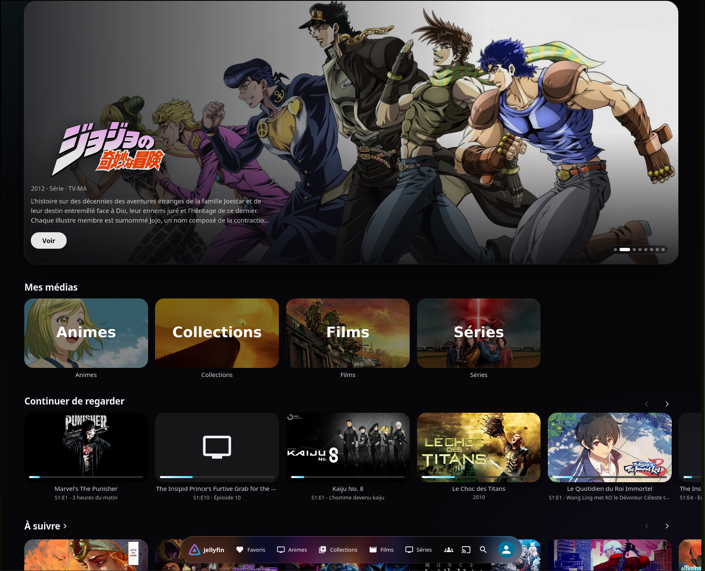

# Jellyfin Dock Theme

Thème très sombre pour Jellyfin, en verre dépoli et tout en rondeurs : la navigation flotte dans un **dock** en bas de l'écran, les affiches se soulèvent avec un **halo cyan** au survol, et les épisodes s'affichent en grande grille.

Un seul fichier CSS, rien à installer sur le serveur, aucun JavaScript.


---

## Installation

1. Dans Jellyfin, ouvrir **Tableau de bord → Branding** (ou *Dashboard → Branding*).
2. Coller cette ligne **tout en haut** du champ **Custom CSS code** :
   ```css
   @import url("https://eaquo.github.io/jellyfin-theme/theme.css");
   ```
3. **Enregistrer**, puis recharger la page (**Ctrl + Maj + R**).

C'est tout : le thème s'applique à tous les utilisateurs et à toutes les applis qui utilisent l'interface web (navigateur, Jellyfin Desktop, Android, iOS).

> **La ligne `@import` doit rester la première.** Un navigateur ignore un `@import` placé après d'autres règles CSS.

Recommandé : choisir le thème **Dark** dans **Paramètres → Affichage**.

### Option : effets avancés (JavaScript)

Le CSS seul suffit. Pour aller plus loin, `theme.js` ajoute :

- **Couleur dynamique** : le halo et les lueurs prennent la couleur dominante de l'affiche ouverte.
- **Bandeau d'accueil** : les derniers ajouts défilent en grand en haut de l'accueil, avec leur logo et leur résumé.
- **Pilules de saisons** : une rangée `S1 · S2 · S3` sur les pages de série et de saison pour changer de saison d'un clic.
- **Mode léger automatique** : sur un appareil lent, le flou est remplacé par une teinte simple pour rester fluide.
- **Surprends-moi** : un dé dans le dock tire au hasard un film ou une série pas encore vus.
- **Badges** : `4K`, `HDR`/`DV`, `VF` ou `VOSTFR` sur les affiches des films et épisodes.



Installation (une seule fois) :

1. **Tableau de bord → Extensions → Catalogue → ⚙️ → +**, ajouter le dépôt :
   `https://raw.githubusercontent.com/n00bcodr/jellyfin-plugins/main/manifest.json`
2. Dans le **Catalogue**, installer **JavaScript Injector**, puis **redémarrer le serveur** Jellyfin.
3. **Tableau de bord → Extensions → JavaScript Injector → Add Script** :
   - **Name** : `Dock Theme`
   - **Script URL** : `https://eaquo.github.io/jellyfin-theme/theme.js`
   - cocher **Enabled**, puis **Save**.
4. Recharger la page.

Forcer le mode léger sur un appareil (console du navigateur, F12) : `localStorage.dockLite = '1'` — ou `'0'` pour le désactiver, puis recharger.

---

## Ce que fait le thème

| | |
|---|---|
| **Dock flottant** | La barre de navigation devient une pilule de verre en bas de l'écran. Dans une bibliothèque, les outils (Tout lire, aléatoire, filtres, tri) forment une deuxième pilule plus discrète juste au-dessus. |
| **Affiches** | Coins arrondis, ombre douce, la carte se soulève avec un léger halo cyan au survol. Les vignettes sans image deviennent du verre teinté. |
| **Pages de détail** | Plus de bande grise : titre, infos et boutons flottent sur le fond. Boutons d'action ronds en verre, « Lecture » en blanc. |
| **Saisons** | Affiches arrondies, titre « Saison 1 » en pilule ; une saison entièrement vue est atténuée. |
| **Épisodes** | Grille de grandes vignettes 16:9 avec le numéro en pastille ronde ; le résumé se déplie au survol. Les épisodes vus sont atténués, l'épisode à reprendre est cerclé de cyan et mis en avant. |
| **Fenêtres et menus** | Fenêtres d'options (Modifier, Identifier…), menus ⋮ et champs de saisie en verre, anneau cyan au focus. |
| **Accessibilité** | Respecte les réglages système *Réduire les animations* et *Réduire la transparence*. |

## Écrans pris en charge

| Écran | Comportement |
|---|---|
| **Ordinateur** | Dock en bas, effets au survol. |
| **Ultrawide (21:9 et plus)** | Le contenu des pages de détail reste centré, le texte ne s'étire pas sur toute la largeur. |
| **Mobile** | Dock en icônes seules, défilable, au-dessus de la barre système ; épisodes sur une colonne avec résumé visible. |
| **TV** | La barre d'origine reste en haut pour la télécommande ; l'élément sélectionné est entouré d'un anneau cyan bien visible de loin. |

---

## Personnaliser

Ajouter les variables à changer **sous** la ligne `@import`, dans le même champ Custom CSS :

```css
:root {
  --glow: 80, 220, 255;   /* couleur du halo, en r, g, b (ici cyan) */
  --accent: #ffffff;      /* boutons actifs et barres de progression */
  --bg: #07070a;          /* fond des pages */
  --radius: 22px;         /* arrondi des cartes et panneaux */
}
```

Exemples de halo : violet `170, 120, 255` · vert `80, 255, 170` · orange `255, 160, 60`.

---

## Dépannage

**Le thème ne s'affiche pas**
- Vérifier que la ligne `@import` est bien la **première** du champ Custom CSS.
- Dans **Paramètres → Affichage**, la case **« Désactiver le CSS personnalisé du serveur »** doit être décochée, et le champ **« CSS personnalisé »** (local au navigateur) de préférence vide.
- Recharger avec **Ctrl + Maj + R** pour ignorer le cache.

**Jellyfin Desktop / Jellyfin Media Player ne change pas**
- Fermer complètement l'application et la rouvrir : elle ne relit le CSS du serveur qu'au démarrage.

**Une mise à jour du thème n'apparaît pas**
- Le fichier peut rester en cache jusqu'à 10 minutes. Recharger avec **Ctrl + Maj + R**.

**Les effets avancés (bandeau, pilules de saisons, couleur dynamique) n'apparaissent pas**
- Vérifier dans **Tableau de bord → Extensions → JavaScript Injector** que le script est bien **Enabled**, avec l'URL `https://eaquo.github.io/jellyfin-theme/theme.js`.
- Recharger avec **Ctrl + Maj + R**.
- Dans le plugin, la case **« Allow external script URLs »** doit être cochée **et enregistrée** (bouton *Save* en bas de la page).
- **Jellyfin Desktop / Jellyfin Media Player** gardent l'ancienne page en cache (le serveur la déclare inchangée). Fermer l'application, vider son cache, puis la rouvrir :
  ```bash
  # Jellyfin Desktop (Flatpak)
  rm -rf ~/.var/app/org.jellyfin.JellyfinDesktop/cache/jellyfin-desktop/profiles/*/QtWebEngine/Cache
  # Jellyfin Media Player (paquet classique)
  rm -rf ~/.local/share/jellyfinmediaplayer/QtWebEngine/Default/Cache
  ```

**« Une erreur s'est produite lors du chargement des plugins » (page Extensions)**

Ce n'est pas lié au thème : la page plante à cause d'un autre dépôt ou plugin. Ouvrir **Tableau de bord → Journaux**, le fichier le plus récent, et chercher :

- `Failed to deserialize the plugin manifest retrieved from "…"` : ce dépôt est mort ou archivé. Le supprimer dans **Extensions → Gérer les dépôts**.
- `Could not find a part of the path '/var/lib/jellyfin/plugins/<Nom>_<version>/meta.json'` : Jellyfin croit un plugin installé alors que son dossier a disparu. Sur le serveur :
  ```bash
  ls -la /var/lib/jellyfin/plugins/
  # si le dossier manque : le recréer pour débloquer la page, puis réinstaller le plugin depuis le Catalogue
  sudo mkdir -p "/var/lib/jellyfin/plugins/<Nom>_<version>"
  sudo chown -R jellyfin:jellyfin "/var/lib/jellyfin/plugins/<Nom>_<version>"
  sudo systemctl restart jellyfin
  ```
  Si le plugin n'est plus utile, supprimer plutôt le dépôt qui le propose, puis redémarrer Jellyfin.

(Installation Docker : le dossier `plugins` se trouve dans le volume monté sur `/config`, et on redémarre le conteneur au lieu de `systemctl`.)

---

## Désinstaller

Supprimer la ligne `@import` du champ Custom CSS, enregistrer, recharger.

---

Testé sur Jellyfin 12.4 dans un navigateur de bureau. Mobile et TV : pris en charge mais pas encore testés sur appareil réel.
